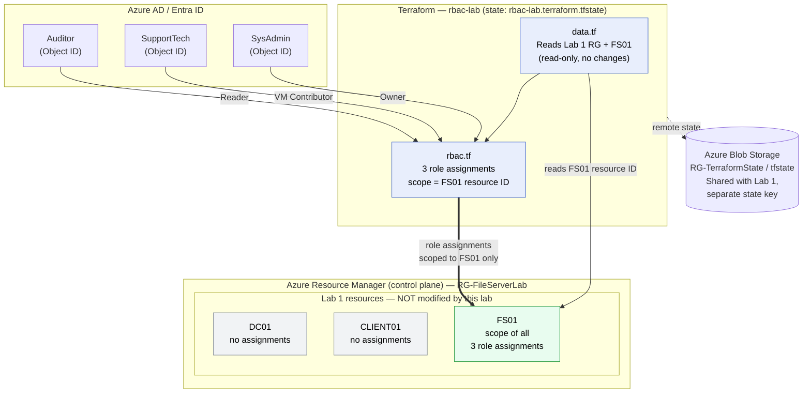

# Lab 2 — Azure RBAC Access Control

**Owner · VM Contributor · Reader — Scoped to FS01 Only · Terraform + PowerShell**

Applies Azure Role-Based Access Control (RBAC) to a single VM using Terraform, demonstrating least-privilege access at the cloud infrastructure layer: three personas, three roles, one resource — fully scoped, tested, and validated.

| | |
|---|---|
| **Depends on** | [Lab 1 — NTFS File Server](../ntfs-lab-terraform) must be fully deployed — `RG-FileServerLab` and `FS01` must exist |
| **What gets created** | 3 role assignments on `FS01` only — no new VMs, no new networking |
| **Deploy time** | Under 1 minute (+ 2–10 min RBAC propagation) |
| **Cost** | Role assignments are free — only Lab 1 VMs incur compute charges |
| **Tooling** | Terraform, Azure CLI, PowerShell, Azure AD / Entra ID |
| **Part of** | 3-lab series — see [Lab Series](#lab-series) below |

This repo is self-contained. Every Terraform and PowerShell file needed is included — no external downloads beyond Terraform and the Azure CLI.

> **Lab 1 must be running before you start.** Confirm:
> ```bash
> az vm list -g RG-FileServerLab --query "[].{name:name,status:powerState}" -o table
> ```
> All three VMs must show `VM running`.

---

## Table of Contents

- [Lab Series](#lab-series)
- [What This Lab Demonstrates](#what-this-lab-demonstrates)
- [Skills Exercised](#skills-exercised)
- [Architecture](#architecture)
- [Repository Structure](#repository-structure)
- [Prerequisites](#prerequisites)
- [Deployment Guide](#deployment-guide)
- [Permission Matrix](#permission-matrix)
- [Testing Each Persona](#testing-each-persona)
- [Teardown](#teardown)
- [Troubleshooting](#troubleshooting)

---

## Lab Series

Lab 2 deploys no new infrastructure. It layers Azure-level access control on top of Lab 1's existing `FS01` VM. That relationship explains why no VMs appear in `terraform plan`, and why this lab shares a storage account with Lab 1 but has its own state file.

| Lab | Deploys | Relationship |
|---|---|---|
| **Lab 1 — NTFS File Server** | `DC01`, `FS01`, `CLIENT01`, VNet, NSG, Key Vault in `RG-FileServerLab` | Standalone — builds all infrastructure from scratch |
| **Lab 2 — Azure RBAC** *(this repo)* | 3 role assignments on `FS01` only, no new VMs | Depends on Lab 1 — reads Lab 1 resources via data sources, reuses Lab 1's storage account |
| **AUM Lab — Azure Update Manager** | `DC01`, `WS01`, `WS02`, VNet, Key Vault in `rg-aumlab` | Standalone — fully independent from Labs 1 and 2 |

**Remote state:** no new storage account is needed. Lab 2 reuses Lab 1's (`RG-TerraformState`); the only difference is the state key — `rbac-lab.terraform.tfstate` vs. `ntfs-lab.terraform.tfstate`. Both live in the same container without affecting each other.

---

## What This Lab Demonstrates

**The problem:** Lab 1 controlled who can access files *inside* a VM. This lab controls who can manage the VM itself *from Azure*.

Different people need different levels of control over cloud infrastructure:

- A **senior sysadmin** needs full control — start, stop, resize, delete, and manage who else has access.
- A **help desk technician** needs to restart an unresponsive server, but must never delete it or change its security configuration.
- An **auditor** needs to view server details for compliance but must not be able to take any action.

Azure RBAC enforces this separation. Every action in Azure — starting a VM, reading its configuration, assigning a role — requires a specific permission, and RBAC lets you grant exactly what a job requires and nothing more: the **principle of least privilege** at the cloud infrastructure level.

**The real-world scenario:** a ticket comes in — the Finance file server is unresponsive. The on-call technician restarts the VM but cannot delete it, change its configuration, or see who else has access. Later, an auditor runs a quarterly review and exports an RBAC report confirming only authorized personnel have access. After a staff change, the senior sysadmin uses Owner rights to reassign roles. Each persona has exactly what the job requires. No one has more.

---

## Skills Exercised

| Skill | Real-world relevance |
|---|---|
| RBAC vs. NTFS | RBAC controls the infrastructure from outside; NTFS controls files inside the OS. A file server with perfect NTFS permissions but no RBAC is still a risk — anyone with portal access could start, stop, or delete the VM |
| Scope role assignments to a single resource | Scoping to one VM's resource ID limits blast radius if an account is compromised |
| Terraform data sources | Read existing infrastructure without recreating or modifying it — the pattern used when one team's Terraform references another's |
| Look up Azure AD Object IDs | Every role assignment requires an Object ID; emails are mutable, Object IDs are not |
| Test role enforcement via Azure CLI | Logging in as each identity proves least privilege is *enforced*, not just assumed |
| Structured validation reporting | Automated, exportable validation is the professional standard for compliance — portal spot-checks are neither auditable nor repeatable |

---

## Architecture



**How it works:** Azure RBAC operates at the Resource Manager control plane — completely separate from the NTFS permissions inside the VM. All three role assignments are scoped to `FS01`'s resource ID only. `DC01` and `CLIENT01` live in the same resource group but receive no assignments.

### Why Each Component Exists

| Component | What it does and why it's needed |
|---|---|
| `data.tf` — data sources | Looks up Lab 1's resource group and `FS01` by name — read-only. Terraform can't create role assignments without `FS01`'s full resource ID. If Lab 1 isn't deployed, these fail with a clear error |
| `rbac.tf` — role assignments | Three assignments scoped to `FS01`'s resource ID. **The `scope` line is the most important line in each assignment** — pointing it at the resource group ID would silently expand the role to every resource in `RG-FileServerLab` |
| **Owner** role | Full control on `FS01`, including managing RBAC. In production, you'd typically split this into Contributor + User Access Administrator for tighter least privilege |
| **Virtual Machine Contributor** role | Start, stop, restart, connect — cannot delete or manage RBAC. Appropriate for help desk |
| **Reader** role | View configuration and status — no actions. Appropriate for auditors and compliance |
| `variables.tf` — Object ID inputs with **no defaults** | If these had defaults, a careless deploy could assign roles to placeholder identities. No defaults means Terraform errors loudly if they're missing — an intentional safety design |
| `01-get-object-ids.ps1` | Translates UPNs to Object IDs. Emails can change; Object IDs never do |
| `validate-lab.ps1` | Confirms assignments are actually live and prints a permission matrix. `terraform apply` confirms Terraform *created* the resource — not that RBAC has *propagated* the permission. This queries live RBAC state directly |
| Separate state key `rbac-lab.terraform.tfstate` | Keeps Lab 2's state isolated. With a shared key, Lab 2's `terraform destroy` would remove Lab 1's resources |

---

## Repository Structure

```
rbac-lab-terraform/
├── backend.tf                 # Reuses Lab 1 storage account, different state key
├── versions.tf                # Provider version requirements
├── variables.tf               # Three Object ID inputs, no defaults
├── data.tf                    # Reads Lab 1 RG and FS01 without modifying them
├── rbac.tf                    # The three role assignments scoped to FS01
├── outputs.tf                 # VM ID, resource group, role assignment IDs
├── terraform.tfvars.example   # Safe template — commit this
├── terraform.tfvars           # Real Object IDs — DO NOT commit
├── .gitignore
├── validate-lab.ps1           # Confirms assignments, prints matrix, exports report
└── scripts/
    └── 01-get-object-ids.ps1  # Translates user emails to Azure AD Object IDs
```

> Keep this as a **separate folder from Lab 1**. Even though Lab 2 references Lab 1's resources, they are independent Terraform projects and must never share a folder or a state key.

---

## Prerequisites

```bash
terraform -version   # >= 1.5.0
az version            # Any recent Azure CLI

# Confirm correct subscription
az account show
# If wrong: az account set --subscription "<name or ID>"

# Confirm Lab 1 VMs are running — all three must show "VM running"
az vm list -g RG-FileServerLab --query "[].{name:name,status:powerState}" -o table
# If stopped:
az vm start --ids $(az vm list -g RG-FileServerLab --query "[].id" -o tsv)
```

**You will also need three existing Azure AD test accounts** (not your own):

| Role assigned | User UPN | Object ID |
|---|---|---|
| SysAdmin — Owner | | |
| SupportTech — VM Contributor | | |
| Auditor — Reader | | |

> **MFA on test accounts:** the testing step requires `az login` as each test user. If your tenant enforces MFA, create these accounts with a Conditional Access exclusion or use a test tenant without MFA.

---

## Deployment Guide

> Full file contents and inline rationale for every file live in [`docs/DEPLOYMENT.md`](docs/DEPLOYMENT.md). Summary below.

1. **Create a separate project folder:**
   ```powershell
   New-Item -ItemType Directory -Path "$HOME\rbac-lab-terraform"
   cd "$HOME\rbac-lab-terraform"
   New-Item -ItemType Directory -Path scripts
   ```
2. **Add the Terraform files:** `backend.tf`, `versions.tf`, `variables.tf`, `data.tf`, `rbac.tf`, `outputs.tf`, `terraform.tfvars.example`, `.gitignore`. In `backend.tf`, set `storage_account_name` to Lab 1's storage account and keep `key = "rbac-lab.terraform.tfstate"`.
3. **Add the scripts:** `scripts/01-get-object-ids.ps1` and `validate-lab.ps1`.
4. **Look up Object IDs** — prompts for three UPNs and prints Object IDs:
   ```powershell
   .\scripts\01-get-object-ids.ps1
   ```
5. **Configure variables:**
   ```powershell
   Copy-Item terraform.tfvars.example terraform.tfvars
   # Paste in the three Object IDs
   # Confirm resource_group_name = "RG-FileServerLab" and vm_name = "FS01" (case-sensitive)
   ```
6. **Deploy and validate:**
   ```bash
   az login && az account show
   terraform init
   terraform plan    # Must show exactly 3 resources — no VMs, networking, or resource groups
   terraform apply   # Under 1 minute

   # Wait 2–3 minutes for RBAC to propagate, then:
   .\validate-lab.ps1
   ```

> **If `plan` shows more than 3 resources:** stop. Check `terraform.tfvars` — `resource_group_name` and `vm_name` must exactly match Lab 1, including capitalization.
>
> **If validation shows FAIL after 5 minutes:** RBAC propagation can take up to 10 minutes in some tenants. Wait and re-run `validate-lab.ps1`.

`validate-lab.ps1` confirms all three assignments, prints the permission matrix, and exports `RBAC_Lab_Report.txt` — a structured, repeatable record suitable for compliance work.

---

## Permission Matrix

Permissions as enforced on `FS01` (scoped to that VM only):

| Action | Owner (SysAdmin) | VM Contributor (SupportTech) | Reader (Auditor) |
|---|:---:|:---:|:---:|
| View VM details | ✅ | ✅ | ✅ |
| Start / Stop VM | ✅ | ✅ | ❌ |
| Connect via RDP | ✅ | ✅ | ❌ |
| Delete VM | ✅ | ❌ | ❌ |
| Manage RBAC roles | ✅ | ❌ | ❌ |

---

## Testing Each Persona

Open a new terminal per test. Log in as the test user, run the commands, confirm the result, then close the terminal. **The FAIL results are not errors — they prove role enforcement is working.**

**Test 1 — Auditor (Reader)**
```bash
az login   # as Auditor
az vm show -g RG-FileServerLab -n FS01 --query "{name:name,size:hardwareProfile.vmSize}"
# Expected: SUCCEEDS — Reader can view VM details
az vm stop -g RG-FileServerLab -n FS01
# Expected: FAILS (AuthorizationFailed) — Auditor cannot stop VMs
```

**Test 2 — SupportTech (VM Contributor)**
```bash
az login   # as SupportTech
az vm start -g RG-FileServerLab -n FS01
# Expected: SUCCEEDS — VM Contributor can start VMs
az role assignment list --scope $(az vm show -g RG-FileServerLab -n FS01 --query id -o tsv)
# Expected: FAILS (AuthorizationFailed) — cannot view or manage RBAC
```

**Test 3 — SysAdmin (Owner)**
```bash
az login   # as SysAdmin
az vm show -g RG-FileServerLab -n FS01 --query "{name:name}"
# Expected: SUCCEEDS
az role assignment list --scope $(az vm show -g RG-FileServerLab -n FS01 --query id -o tsv)
# Expected: SUCCEEDS — Owner can view and manage RBAC
```

**Restore your own account**
```bash
az login
az account show   # Confirm your subscription is active
```

---

## Teardown

```bash
# Option A — remove RBAC only, keep Lab 1 VMs running
terraform destroy

# Option B — full teardown, completely done with both labs
terraform destroy                                       # Remove RBAC first
az group delete -n RG-FileServerLab --yes --no-wait     # Remove all Lab 1 resources
az group show -n RG-FileServerLab 2>&1                  # Expect: ResourceGroupNotFound
```

---

## Troubleshooting

| Problem | Cause | Solution |
|---|---|---|
| `terraform apply`: principal not found | Object ID is wrong or the account was deleted | Re-run `01-get-object-ids.ps1`, update `terraform.tfvars`, re-apply |
| `terraform apply`: resource group not found | Lab 1 isn't deployed | Deploy the NTFS lab first — `RG-FileServerLab` must exist |
| Validate shows FAIL after 10+ minutes | Role assignment missing from Terraform state | `terraform state list` — confirm three `azurerm_role_assignment` resources. If missing, re-apply |
| `az vm stop` succeeds for Auditor | RBAC still propagating | Wait 5 minutes and retest |
| Plan shows more than 3 resources | `resource_group_name` or `vm_name` mismatch | Check capitalization — `FS01` is not `fs01` |
| MFA prompt when logging in as test user | Tenant enforces MFA | Create a Conditional Access exclusion for test accounts, or use a test tenant without MFA |

---

**Stack:** Terraform · Azure CLI · PowerShell · Azure RBAC · Azure AD / Entra ID · Terraform Remote State
